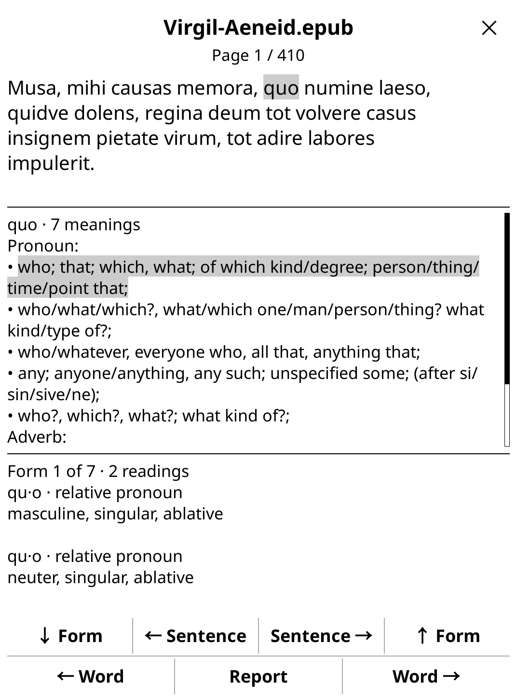
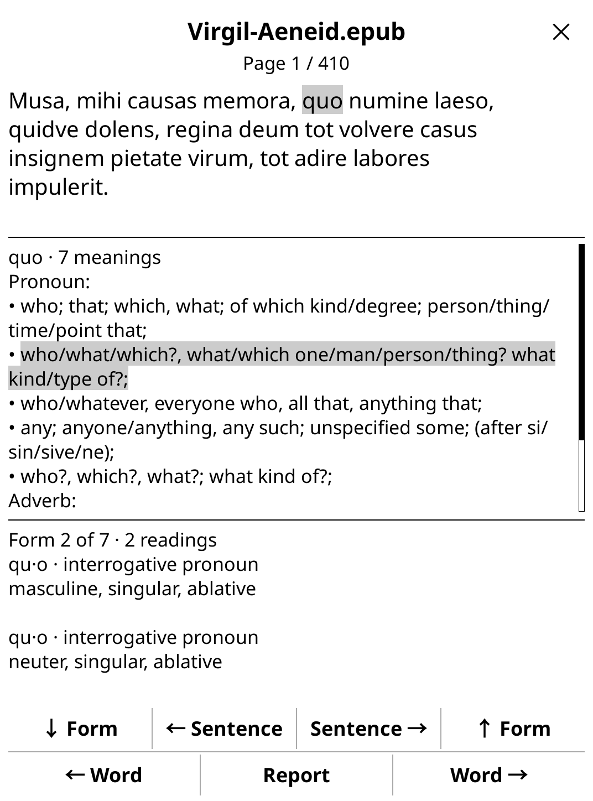
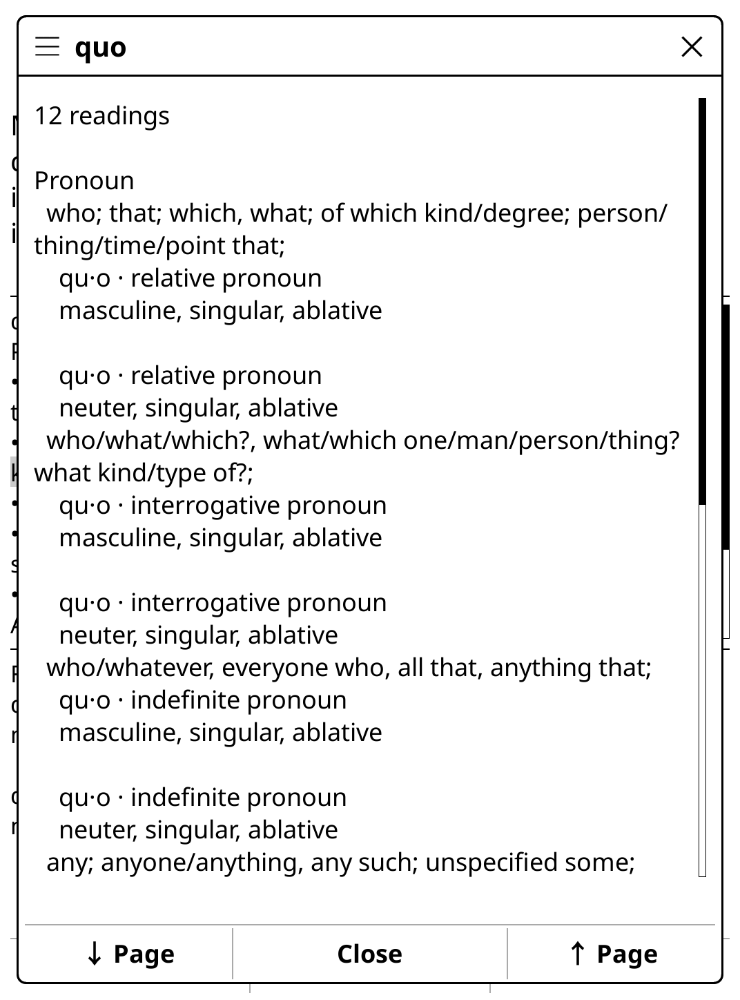

# WhitakerLib Kindle

A KOReader plugin for reading Latin on a Kindle or other e-reader, built on
[whitakerLib](https://github.com/ddd2951/whitakerLib), a library that
reproduces the analyses of William Whitaker's WORDS.

- **Tap a word** in the sentence you're reading to see its meanings, grouped by
  part of speech.
- **Step through its forms** to see the stem and ending, declension or
  conjugation (or, for pronouns, their kind), and grammatical possibilities.
- **Offline.** Everything runs on the device.
- **Small.** About a thousand lines of Lua, plus the library.

## An early version

This is an early version. I use it to read Latin on my own Kindle, and it
works well enough that I wanted to share it. It's deliberately thin for now.

What's next:

- **A dictionary word's stems.** whitakerLib 0.4.1 adds them, and the plugin
  will show them with each form (*am-, amav-, amat-*), so you can see which
  dictionary word a form belongs to.
- **Builds for other e-readers,** on request (see
  [Other e-readers](#other-e-readers)).

If you could see yourself using this, but there's something missing that would
make it useful to you, I'd really love to hear about it.
[Open an issue](https://github.com/ddd2951/whitakerLib-kindle/issues) and tell
me what you'd like it to do.

Everything the plugin shows comes through whitakerLib's public C interface, the
same one any other program can use. That's deliberate: the plugin is a real use
of the library, and what it finds missing there is what the library gets next.

## Using it

Open a book and choose **Tools → More tools → WhitakerLib Reader**.



The sentence is at the top. Tap a word, or move through the text with
**← Word** and **Word →**. Its meanings appear in the middle, grouped by part
of speech, and one form appears at the bottom.

**↓ Form** and **↑ Form** step through the forms. The meaning belonging to the
current form is highlighted, and tapping a meaning jumps to its first form.
**Report** opens the whole word on one scrollable page, with all its meanings
and forms.

 

**← Sentence** and **Sentence →** move through the book, across pages and
chapters. The close button returns KOReader to the sentence you were on.

## Install

For a Kindle compatible with KOReader's `kindlepw2` build (tested on the
Paperwhite 3), download `whitaker-kindle.zip` from the
[Releases](https://github.com/ddd2951/whitakerLib-kindle/releases) page and
unzip it into `koreader/plugins/` on the e-reader over USB, replacing an older
copy. Then restart KOReader. Nothing needs compiling.

For another device, build the plugin yourself (below) and copy
`whitaker.koplugin/` the same way, or ask for a build
([Other e-readers](#other-e-readers)).

The reader works with reflowable books opened through KOReader's Cool Reader
engine, including ordinary EPUBs. It does not support PDF.

## Build

`whitakerLib/` is a submodule pinned to the library revision tested with this
plugin. Clone it along with the repository:

```sh
git clone --recursive https://github.com/ddd2951/whitakerLib-kindle.git
cd whitakerLib-kindle
python3 build.py --toolchain-root <toolchain>/x-tools/arm-kindlepw2-linux-gnueabi
```

The build needs CMake, Ninja, Clang with C++23 and `#embed` support, Python 3,
LuaJIT, and KOReader's kindlepw2 toolchain (from koxtoolchain).

It cross-compiles the library using the toolchain's headers, sysroot and
linker, generates LuaJIT FFI declarations from the library's C header, checks
the Lua files' syntax, and produces:

- `build/dist/whitaker.koplugin/`
- `build/whitaker-kindle.zip`

The build does not install or deploy anything.

## What it touches

I tried to keep the plugin light and make it clear what it does.

- **Loads** `libwhitaker.so.0` and reads `whitaker_ffi.h`, both from its own
  folder. `backend.lua` is the only file that calls into C.
- **Reads** the open book's text through KOReader's document interface. It
  supports reflowable documents handled by Cool Reader, not fixed-page formats
  such as PDF.
- **Writes nothing,** deletes nothing, runs no commands and uses no network.

`libwhitaker.so.0` is the one file that cannot be inspected as source.
`BUILD.txt`, beside it, records the plugin and library revisions used for the
build, together with the SHA-256 hashes of the library and its dictionary.

The library's own README explains what its readings contain and how closely
they match WORDS. See
[whitakerLib's README](https://github.com/ddd2951/whitakerLib#readme).

## Other e-readers

KOReader runs on many e-readers. This plugin uses KOReader's widgets and
document interface, so the Lua side should be portable, but I've only tested it
on my Paperwhite 3. The native library must be built for each device's
architecture and system; `build.py` currently does that for the Paperwhite.

If something in it turns out to block it on some devices, let me know and I'll
look into it.

If you'd like a ready-made build for another e-reader, ask.
[Open an issue](https://github.com/ddd2951/whitakerLib-kindle/issues) with the
device and its KOReader version, and I'll try to make one. I can't test it
without the device, so I'll need you to tell me whether it works.

If you try it on another e-reader yourself, I'd love to hear whether it works,
or what went wrong if it doesn't: the device, KOReader version and what you
saw.

## Licence

The plugin is licensed under the European Union Public Licence v. 1.2
(`LICENSE`), like whitakerLib. The WORDS data inside the library is a separate
work under Whitaker's notice; the build copies that notice into the plugin as
`LICENSE.WORDS`.
